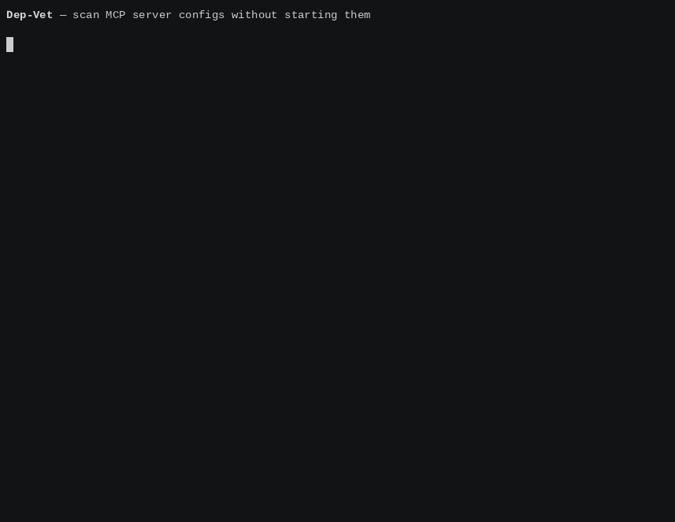

<div align="center">


<h1>Dep-Vet</h1>

**A dependency risk scanner for the moment before trust is granted.**

<p>


<a href="https://crates.io/crates/dep-vet"></a>
<a href="https://www.npmjs.com/package/@nassihyas/dep-vet"></a>
<a href="https://registry.modelcontextprotocol.io/v0.1/servers?search=dep-vet"></a>


</p>

</div>

```sh
npx @nassihyas/dep-vet npm express@5.3.0
npx @nassihyas/dep-vet audit package-lock.json
npx @nassihyas/dep-vet guard --check -- npm i express
```

One Rust binary. No account, no API key, no telemetry, no score out of 100. It
never installs or executes the package it checks.

<p align="center">
  
</p>

---

## Why vet a dependency before installing it?

Installing a dependency is remote code execution by design. `npm install` runs
`postinstall` hooks and resolves a tree nobody reads. A Python sdist runs a
build backend. A package can change hands between two releases.

Post-install tools answer a different question after the decision is made:

- `npm audit` tells you that a version already in your lockfile has a known
  advisory. It does not care that the package's `postinstall` already ran.
- Dependabot and Renovate track updates to dependencies you already trust.
- OSV-Scanner reads lockfiles, which exist only after the install.

Dep-Vet checks the package you are about to trust: what it runs at install time,
who published this version and before, whether the name is one edit away from
one you meant, which advisories apply to this exact version, whether it is
exploited in the wild, what the source repository looks like, and what text the
package ships. Every finding links to the evidence that produced it.

`axios@1.14.1` is the shape of the gap: one added dependency whose only job was
a `postinstall` hook — transitive, invisible in `package.json`, and already
running by the time an audit exists.

## Example output

A typosquat, and a clean package, from the same command:

```console
$ npx @nassihyas/dep-vet npm crossenv
npm/crossenv@0.0.2-security

  verdict      HIGH (exit 2)
  first seen   2017-07-19
  published    2017-08-02
  maintainers  npm

  1 finding

  [HIGH]  name is close to a popular package
        'crossenv' is 1 edit(s) away from the popular package 'cross-env'
        -> https://www.npmjs.com/package/crossenv/v/0.0.2-security
```

```console
$ npx @nassihyas/dep-vet npm express@5.3.0
npm/express@5.3.0

  verdict      INFO (exit 0)
  first seen   2010-12-29
  maintainers  dougwilson, ulisesgascon
  repository   https://github.com/expressjs/express
  license      MIT

  no findings: nothing in the registry metadata stands out
```

### Exit codes are part of the interface

| Code | Meaning |
|---|---|
| `0` | clean, or informational findings only |
| `1` | warnings: review before adding |
| `2` | high risk: a HIGH finding such as malware-shaped install behavior or a near-identical name |
| `3` | the check could not run or could not finish (bad input, network failure, unreadable response, a lockfile package that could not be fetched) |

`3` exists so CI can tell "this package is risky" from "the scanner broke or was
called wrong". clap's own usage-error exit is `2`, which would read as "high
risk", so parse failures are remapped to `3`; `--help` and `--version` still
exit `0`.

A reproducible run on a real project, with captured output and why one audit
honestly exits `3`, lives in
[`examples/nodegoat`](examples/nodegoat).

## Four moments, four tools

### Before adding one package

```sh
dep-vet npm express@5.3.0            # pypi, crates, go, jsr, gem, nuget, maven, composer
dep-vet npm crossenv --json
```

Reads registry metadata and OSV advisories for that exact version. In npm it
also reads the packument's install hooks. When a `package-lock.json` is nearby,
its names join the typosquat comparison; `--no-local` turns that off.

### Before merging a change

```sh
dep-vet lock package-lock.json --base origin/main
dep-vet audit package-lock.json
dep-vet watch package-lock.json       # re-audit on every save
```

`lock` audits only packages a change adds (a version bump counts as new).
`audit` audits the whole installed tree and reports the worst verdict. Supported
inputs:

| Input | Ecosystem | Incomplete when |
|---|---|---|
| `package-lock.json` v2/v3 | npm | v1 lockfile (upgrade with `npm install`) |
| `bun.lock`, `pnpm-lock.yaml` (v5/v6/v9), `yarn.lock` (classic/Berry) | npm | unreadable entries |
| `requirements*.txt`, `Pipfile.lock`, `poetry.lock`, `uv.lock` | PyPI | unpinned lines, git/path/URL sources, `*` versions |
| `Cargo.lock` | crates.io | git dependencies |
| `go.mod` | Go | unreadable require lines (`replace` is ignored) |
| `Gemfile.lock` | RubyGems | `PATH`/`GIT` sections |
| `packages.lock.json`, `packages.config` | NuGet | unresolved entries, project references |
| `composer.lock` | Composer | path/git/URL sources |
| `gradle.lockfile` | Maven | unlocked configurations |
| `maven-tree.txt` | Maven | a malformed line or an empty tree |
| `deno.lock` | npm + JSR | JSR advisories do not exist |

For Maven, generate the input with Maven itself:

```sh
mvn dependency:tree -DoutputFile=maven-tree.txt
dep-vet audit maven-tree.txt
```

The file and the copied log both parse. Versions are Maven's decisions, never a
range; profiles and BOM imports are Maven's job. An unreadable line exits `3`.

### Before installing a new tree

```sh
dep-vet plan npm express@5                 # resolve a range, print the tree
dep-vet plan maven com.example:app@1.0.0   # POMs, parents, BOMs, mediation
dep-vet plan maven ./pom.xml               # a local project's declared deps
dep-vet tree package-lock.json             # the graph npm already resolved
```

`plan` never installs or downloads a tarball. npm ranges are resolved from
packuments; Maven is resolved from POMs, applying parent chains, properties,
`dependencyManagement`, imported BOMs, exclusions, and nearest-definition
mediation. Profiles, version ranges, and `LATEST`/`RELEASE` are reported as
unresolved, not guessed. Both resolvers are bounded and exit `3` on a required
unresolved edge or truncation.

`tree` is offline and reads only `package-lock.json` v2/v3.

### Before releasing, and inside agents

```sh
dep-vet inspect npm lodash@4.17.20            # download, verify, scan
dep-vet diff npm lodash@4.17.20 lodash@4.17.21
dep-vet workflows .github/workflows           # GitHub Actions rules
dep-vet mcp-config --user                     # MCP server configs, never started
dep-vet guard --check -- npm i express        # vet an install command
```

`inspect` verifies the archive's checksum, extracts it in memory, and scans
source text without executing it. `diff` compares two releases by publisher,
provenance, dependencies, integrity, and advisories. `guard` parses an install
command and audits the packages it names. `workflows` and `mcp-config` scan the
automation around your project.

## Supported ecosystems

| Ecosystem | Tier | Checked | Not checked |
|---|---|---|---|
| npm | Full | advisories, install scripts, typosquats, maintainers/publisher history, downloads, provenance and attestation verification, repository, deprecation, freshness, license, Scorecard, archive `inspect`, `tree`/`plan` | — |
| PyPI | Full | advisories, sdist build, provenance presence, yanked releases, dependency history, repository, license, Scorecard, archive `inspect` | maintainers, downloads |
| crates.io | Full | advisories, owners, publisher, yanked releases, repository, dependency history, license, Scorecard | install scripts (no file list), downloads, provenance |
| Composer | Full | advisories, maintainers, abandoned flag, repository, dependency history, license, Scorecard, archive `inspect` | install scripts, downloads |
| RubyGems | Basic | advisories, repository, yanked releases, license, freshness | maintainers, downloads, install scripts, dependency history |
| NuGet | Basic | advisories, deprecation, dependency history, license | repository, maintainers, downloads, install scripts |
| JSR | Basic | repository, deprecation, freshness | advisories (OSV does not publish JSR), maintainers, downloads, install scripts |
| Maven / AndroidX | Basic | advisories, versions; `plan maven` reads POM trees | repository, maintainers, downloads, install scripts, deprecation |
| Go | Basic | advisories, versions | repository, maintainers, downloads, install scripts, dependency history |

"Basic" means the registry does not expose the missing signals; the report lists
them under `not checked` instead of treating absence as a pass.

## What gets checked

| Area | Signals |
|---|---|
| Known risk | OSV advisories for this exact version, merged by alias (PYSEC/GHSA/CVE), with fixes when published |
| Exploitation | EPSS probability and percentile; CISA KEV listing as a separate WARN finding with ransomware context |
| Execution | npm `preinstall`/`install`/`postinstall` hooks; PyPI sdist-only releases (build backend runs) |
| Identity | Typosquat distance to popular names and to your local lockfile; publisher vs maintainer list; publisher history across every release the registry names |
| History | First publish, this version's publish date, release bursts, dormancy, install-script changes, dependency additions, repository changes, provenance drops |
| Source reputation | OpenSSF Scorecard overall score and five checks; license (SPDX-normalised) |
| Archive contents | Network + credential access, encoded payloads passed to `eval`, shell pipes, binaries, prompt-injection text and invisible characters |
| Automation | Unpinned actions, `pull_request_target` checkouts, script injection, `write-all`, pipe-to-shell, secret echo, persisted credentials, artifact downloads, self-hosted PRs, `secrets: inherit`, `$GITHUB_ENV` writes |
| Agent configs | Network launchers, unpinned MCP packages, literal secrets (redacted), non-https URLs, unknown script hosts, prompt-injection text, unreadable servers |

### How Dep-Vet compares to npm audit and Socket

| | Dep-Vet | `npm audit` | Socket.dev |
|---|---|---|---|
| Runs before install | **Yes** — checks a name/version or a lockfile tree before anything executes | No — needs a lockfile or an install, and reports after the fact | **Yes** — analyzes packages before install |
| Account / API key | None | None for the npm CLI; registry access only | Account and GitHub app or CLI token for private analysis |
| Speed / runtime | Single static Rust binary; public registry + OSV requests, with a local cache | npm CLI; network per run | Cloud analysis; depends on the service and plan |
| Evidence transparency | Every finding links to its OSV record, registry field, EPSS/KEV entry, Scorecard, or workflow line | Advisory IDs and severities from the npm advisory database | Proprietary risk signals and scores |
| CI exit codes | `0` clean, `1` warning, `2` high risk, `3` incomplete | `1` when vulnerabilities are found | CLI exit codes; cloud alerts are the primary channel |

## Configure it for your project

`dep-vet` reads the nearest `.depvet.toml` walking up, or the path passed to
`--config`. Unknown keys and invalid values are exit `3`.

```toml
# Exceptions keep the evidence and stop affecting the exit code.
[[allow]]
package = "crossenv"
finding = "typosquat"          # optional; omit to allow every finding
reason = "internal fork, reviewed 2026-11"

# Install thresholds. Every key is optional and off by default.
[policy]
min_age_days = 30
min_weekly_downloads = 1000
require_provenance = true
max_advisory_severity = "high"
allowed_licenses = ["MIT", "Apache-2.0", "BSD-3-Clause"]
denied_licenses = ["GPL-3.0-only"]  # always HIGH
severity = "warn"                   # info, warn, or high

# Archive inspection limits.
[inspect]
max_download_mb = 25
max_total_mb = 100
max_entries = 10000
max_file_mb = 5
max_decompressed_mb = 200
disabled_rules = ["PY-IMPORT-001"]
```

A missing age, download figure, provenance signal, or license is reported as
`not checked`, never as passing. Caps are validated at parse time; an oversized
number is an error, not a wrapped limit.

## CI/CD Integration (GitHub Actions)

Copy [`examples/github-action.yml`](examples/github-action.yml) into
`.github/workflows/`. It runs the reusable workflow on pull requests, diffs the
lockfile against the base, keeps one sticky comment, and fails on exit `2` or
`3`; warnings (`1`) pass with the findings visible.

```yaml
name: dependency review
on: pull_request
permissions:
  contents: read
  pull-requests: write
jobs:
  dep-vet:
    uses: nassih-yassine/Dep-Vet/.github/workflows/dep-vet.yml@v0.16.1
    with:
      lockfile: package-lock.json
      ref: v0.16.1
```

The action also evaluates `.depvet.toml` from the **base** revision, so a pull
request cannot add allow entries or loosen `[policy]` to pass its own check.
`ref` pins the binary; `uses:` alone only pins the workflow file.

For other CI systems:

```sh
dep-vet audit package-lock.json --format sarif -o results.sarif
```

`--format` is audit-only and conflicts with `--json`; `-o` writes the file but
never changes the exit code. SARIF maps High to `error`, Warn to `warning`, and
Info to `note`.

## Scanning the automation around your project

Two scanners cover files that package registries never see:

```sh
dep-vet workflows .github/workflows   # 11 rules over workflow YAML
dep-vet mcp-config --user             # Claude, Cursor, Windsurf, VS Code, Cline
```

The workflow scan is a text pass, not a YAML engine: it flags unpinned actions,
`pull_request_target` checkouts, event data in shell scripts, `write-all`,
pipe-to-shell installers, secret echoes, persisted credentials, `workflow_run`
artifact downloads, self-hosted PRs, `secrets: inherit`, and `$GITHUB_ENV`
writes. It documents what it cannot see and points at zizmor/actionlint for a
deeper review.

The MCP scan never starts a server. It reads JSON/JSONC configs and reports
network launchers, unpinned packages, literal secrets (redacted), non-https
URLs, unknown script hosts, text aimed at a model, and entries it cannot read.
The resolved command line is never printed because its arguments can carry
secrets.

<p align="center">
  
</p>

## Agents and MCP

`dep-vet guard --check -- npm i foo` parses an install command, audits the named
packages, and returns the normal verdict codes. It is a best-effort parser, not
a shell: `$(...)`, `eval`, nested shells, URLs, VCS/path specs, and bare
`npm install` are noted, not silently passed.

```sh
dep-vet hook install claude --write     # Claude Code PreToolUse hook
dep-vet mcp                             # stdio JSON-RPC MCP server
dep-vet mcp --print-config              # .mcp.json snippet
```

The Claude hook always exits `0` and prints one `hookSpecificOutput` object,
because Claude treats exit `2` as BLOCK while dep-vet uses it for HIGH. HIGH
denies, WARN asks (deny with `--strict`), clean allows, and an audit that cannot
run is allowed unless `--strict`.

The MCP server exposes `vet_package`, `vet_command`, and `vet_lockfile_change`.
It is listed in the official MCP Registry as
`io.github.nassih-yassine/dep-vet`, and in the
[Glama MCP directory](https://glama.ai/mcp/servers/nassih-yassine/Dep-Vet):

[](https://glama.ai/mcp/servers/nassih-yassine/Dep-Vet)

In OpenCode, configure it under `mcp.servers`:

```jsonc title="opencode.jsonc"
{
  "$schema": "https://opencode.ai/config.json",
  "mcp": {
    "servers": {
      "dep-vet": {
        "type": "local",
        "command": ["dep-vet", "mcp"],
      },
    },
  },
}
```

<p align="center">
  
</p>

## Output formats

```sh
dep-vet npm express --json                  # one package
dep-vet audit package-lock.json --json      # whole tree
dep-vet audit package-lock.json --format sarif -o results.sarif
dep-vet sbom package-lock.json --format cyclonedx
dep-vet sbom package-lock.json --format spdx -o sbom.json
dep-vet lock package-lock.json --base main --json
```

JSON findings include `severity` and `confidence`: how bad the finding would
be, and how sure the rule is. Human output is the default; colors appear only on
a terminal (`--no-color`/`NO_COLOR` off, `FORCE_COLOR` on). The SBOM is an
inventory from lockfile data: licenses it cannot read stay `NOASSERTION`, and
provenance is never invented.

## Staying current

`dep-vet update` reports the latest release and the command for the channel this
binary came from (Homebrew, Cargo, npm, Scoop, Docker, or a distro package).
`--check` exits `1` when a newer release exists and `0` when current; a failed
check is `3`, never `2`.

```sh
dep-vet update
dep-vet update --check
```

## Cache and network

Responses are cached in `~/.cache/dep-vet` (platform equivalent elsewhere):
registry metadata for 24 hours, advisories for five minutes, verified archives
for 30 days. A fresh entry skips the network; a stale entry is used only after a
network error, `5xx`, or `429`, and a `404` never falls back. `--no-cache`
bypasses it.

What that buys, measured on a 1,090-package lockfile (OWASP NodeGoat pinned at
`c5cb68a`, release build, i7-11800H): 118.26 s cold, 1.45 s warm, with 1,866
cache entries and 115 MiB after the cold run. The script and method are in
[`examples/benchmark`](examples/benchmark/README.md).

Network errors, `429`, and `5xx` retry up to three times with exponential
backoff; `Retry-After` is honoured up to five seconds. The passive update hint is
the exception: one attempt, two seconds, cached for 24 hours, with a six-hour
negative cache. Disable it with `DEPVET_NO_UPDATE_CHECK=1` or
`NO_UPDATE_NOTIFIER=1`.

Archive and provenance URLs come from registry data and are treated as
untrusted: `https` only, known ecosystem hosts, no credentials, no private or
loopback addresses, manual redirects with no downgrade, and DNS answers filtered
before connecting. The full rules are in
[SECURITY.md](SECURITY.md#outbound-url-policy). Development overrides require
`DEPVET_ALLOW_INSECURE_BASES=1` or `--dev-registry`.

## Install

**npm**

```sh
npx @nassihyas/dep-vet npm express@5.3.0
npm install --global @nassihyas/dep-vet
```

**Cargo**

```sh
cargo install dep-vet
```

**Homebrew**

```sh
brew tap nassih-yassine/tap
brew trust nassih-yassine/tap
brew install dep-vet
```

**Windows — Scoop**

```powershell
scoop bucket add nassih-yassine https://github.com/nassih-yassine/scoop-bucket
scoop install nassih-yassine/dep-vet
```

**Docker**

```sh
docker run --rm -v "$PWD:/work" -w /work ghcr.io/nassih-yassine/dep-vet:latest audit package-lock.json
```

**Prebuilt archives and packages:** Linux/macOS shell installer, Windows
PowerShell installer, `.deb`, `.rpm`, `.apk`, and pacman packages on the
[releases page](https://github.com/nassih-yassine/Dep-Vet/releases). AUR:
`packaging/aur/PKGBUILD` builds `dep-vet-bin` from the same static binaries.

## Verify what you downloaded

No channel asks for blind trust. Each proves something narrower than "safe":

| Channel | Integrity | Authenticity |
|---|---|---|
| GitHub release archives | `.sha256` sidecar and aggregate `sha256.sum` | SLSA provenance attestation from `release.yml` |
| npm | registry tarball digest | no published version carries provenance yet (account 2FA blocks trusted publishing) |
| Docker | image digest | cosign keyless signature, SBOM, and provenance |
| crates.io | `.crate` checksum from the index | none: crates.io does not sign artifacts |
| Linux packages | built in CI from the attested musl archives | SLSA attestation from `packaging.yml` |

```sh
sha256sum -c dep-vet-x86_64-unknown-linux-musl.tar.xz.sha256
gh attestation verify dep-vet-x86_64-unknown-linux-musl.tar.xz \
  --repo nassih-yassine/Dep-Vet \
  --signer-workflow nassih-yassine/Dep-Vet/.github/workflows/release.yml \
  --source-ref refs/tags/v0.16.1
```

`inspect npm` verifies Sigstore bundles offline against the embedded PublicGood
root; audits never claim cryptographic verification.

## Scope and limits

- **Not a replacement for `npm audit`, Dependabot, or a hosted service.** It
  adds the pre-install question those tools skip.
- **Not a risk score.** A number hides the evidence; findings name the rule,
  the value, and a link.
- **Never executes package code** during `audit`, `lock`, `guard`, `inspect`, or
  `diff`, and never extracts archives to disk.
- **Advisories describe the named version**, not the transitive install scripts
  it would run.
- **Transitive coverage depends on input**: lockfiles give the installed tree,
  `plan` resolves npm/Maven, single-package commands are direct only.
- **Missing signals are labelled** under `not checked`, never treated as a pass.
- **Typosquatting is a seed list**, not a download ranking; names under four
  characters are skipped, and an established package is never flagged for
  resembling a nearby one.
- **Agent hooks are advisory against a hostile agent.** Absolute paths,
  `python -c`, nested subprocesses, and a bare `npm install` can bypass the
  command parser.
- **Workflow and MCP scans are text passes**, not YAML/semantic engines. They
  document what they cannot see; use zizmor/actionlint or a full analyzer when
  that matters.
- **Maven has no lockfile.** Trees come from `mvn dependency:tree`, or from
  `plan maven` resolving POMs; profiles and multi-module local parents are not
  approximated.

## Development

```sh
cargo test                              # unit + end-to-end suite
cargo test signals::                    # one module
cargo test --test cli fresh_package     # one end-to-end case
cargo clippy --all-targets -- -D warnings
cargo fmt --check
```

Tests never touch the public registry: `tests/cli.rs` starts a local HTTP server
and points the binary at it through `DEPVET_*_BASE` variables, with the cache
disabled except in cache tests.

Enable the tracked hooks once per clone:

```sh
git config core.hooksPath .githooks
```

`pre-commit` vets staged lockfiles (`lock --base HEAD`; full `audit` for a newly
added file; blocks on exit 2/3). `pre-push` runs fmt, clippy, the full test
suite, then the workflow and MCP self-scans.

The CI `dogfood` job runs `dep-vet audit Cargo.lock`, scans every hand-written
workflow, and scans the MCP configs on every push. The generated
`release.yml` is printed to the step summary instead of failing the job.

### Layout

| File | Owns |
|---|---|
| `src/cli.rs` | clap surface |
| `src/model.rs` | specs, severity, findings, reports |
| `src/signals.rs` | the pure rule set: metadata in, findings out |
| `src/lockfile.rs` | lockfile parsing, git-ref diff, Maven tree text |
| `src/plan.rs`, `src/maven_plan.rs` | npm and Maven tree resolution |
| `src/registry.rs`, `src/pypi.rs`, `src/crates.rs` | npm, PyPI, crates.io clients |
| `src/go.rs`, `src/jsr.rs`, `src/rubygems.rs`, `src/nuget.rs`, `src/maven.rs`, `src/composer.rs` | other ecosystem clients |
| `src/osv.rs`, `src/exploit.rs` | advisories, EPSS, CISA KEV |
| `src/scorecard.rs`, `src/license.rs` | repository score, SPDX normalisation |
| `src/archive/`, `src/rules.rs`, `src/inspect.rs` | bounded archive extraction, source rules, release diff |
| `src/guard.rs`, `src/intent.rs`, `src/hook/`, `src/mcp.rs` | agent and CI surfaces |
| `src/workflows.rs`, `src/mcp_config.rs` | workflow and MCP config scans |
| `src/sbom.rs`, `src/sarif.rs` | inventory and code-scanning output |
| `src/http.rs`, `src/cache.rs`, `src/netpolicy.rs` | HTTP policy, cache, outbound URL checks |
| `src/report.rs`, `src/progress.rs` | rendering and the stderr progress bar |

## Roadmap

- Multi-module Maven reactor resolution and profile evaluation.

## License

MIT. Dep-Vet is not affiliated with npm, PyPI, crates.io, Go, JSR, RubyGems,
NuGet, Maven, Composer, OSV, FIRST, CISA, Google, OpenSSF, or Socket.
