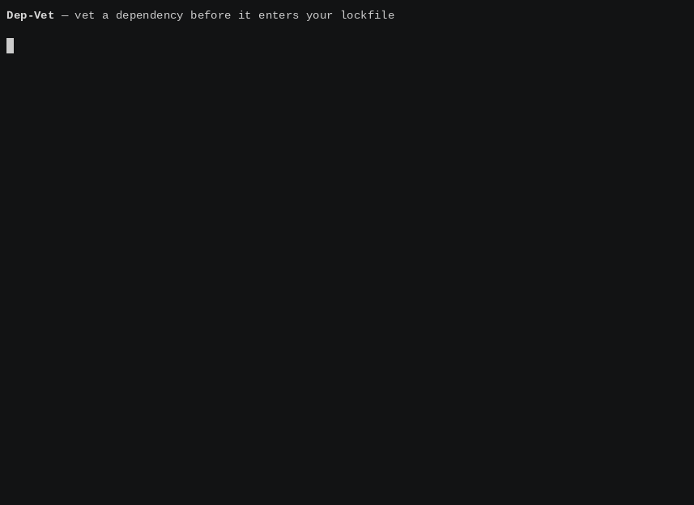
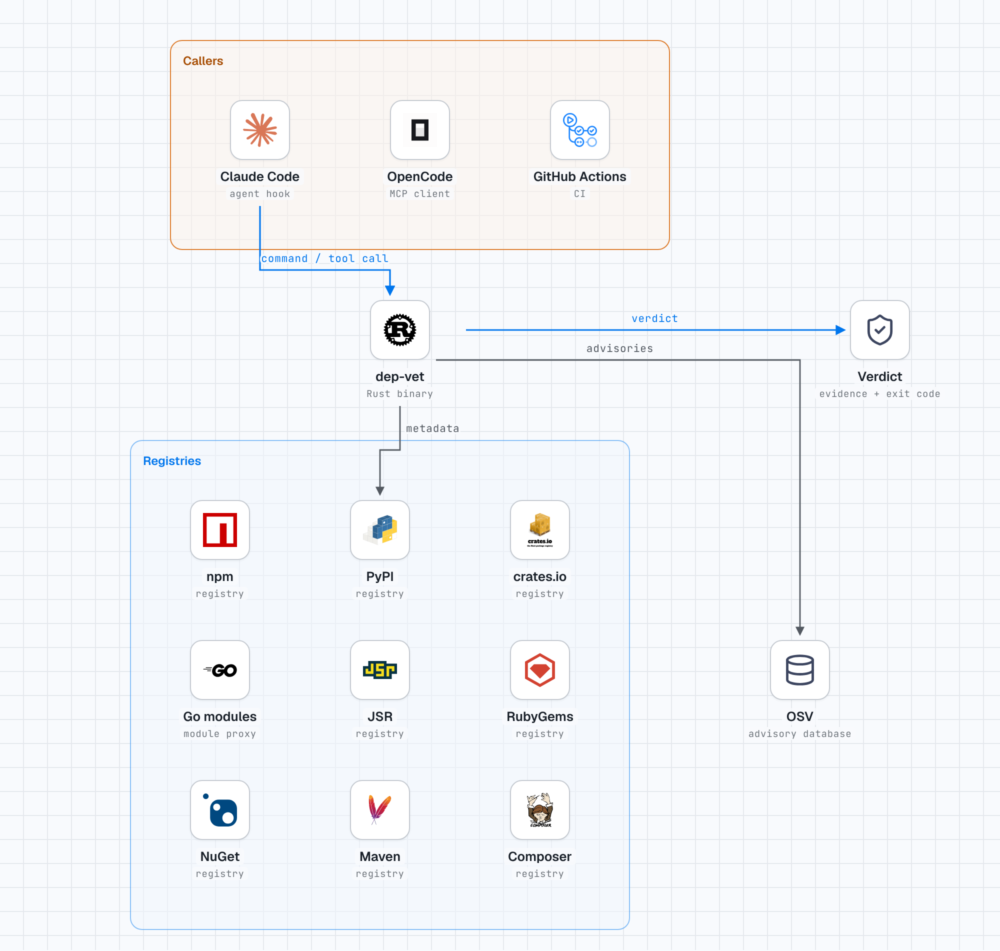
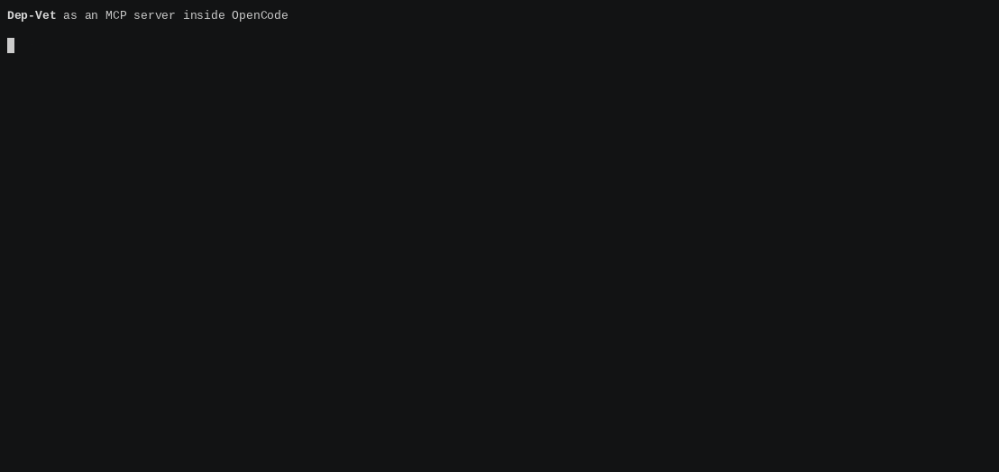

<div align="center">


<h1>Dep-Vet</h1>

**Vet a package for supply-chain risk before it enters your lockfile.**

<p>


<a href="https://crates.io/crates/dep-vet"></a>
<a href="https://www.npmjs.com/package/@nassihyas/dep-vet"></a>
<a href="https://registry.modelcontextprotocol.io/v0.1/servers?search=dep-vet"></a>


</p>

</div>

```sh
npx @nassihyas/dep-vet npm express@5.3.0
npx @nassihyas/dep-vet audit package-lock.json
npx @nassihyas/dep-vet guard --check -- npm i express
```

One binary, no account, no API key, no telemetry. It never installs or executes
the package it checks.

<p align="center">
  
</p>

---

`npm install` runs code, and so does a Python sdist build. `dep-vet` reads
public registry metadata and OSV advisories for **npm, PyPI, crates.io, Go modules, JSR, RubyGems, NuGet, Maven, and Composer**, then tells you
what a package will do at that moment: whether it runs install-time code, how
old it is, who published this version, whether its name is one typo away from a
package you trust, what vulnerabilities apply to this exact version, and whether
it is deprecated. Every finding links to the raw
evidence it came from.

It also reads the text a package ships: zero-width and bidi characters that hide
content from a reviewer, and phrasing aimed at a model rather than a person. Both
are disclosed as heuristics, never as a verdict.

No account, no API key, no telemetry, no score out of 100. One binary for the
CLI, agent hooks, and MCP.

## Why vet dependencies before installing?

`npm install` runs package code, and so does a Python sdist build. Post-install
scanners answer a different question after that moment has passed: is the
version I already installed known to be vulnerable? They do not look at the
`postinstall` hook that just ran, the maintainer who changed last week, or the
name that is one edit away from the one you meant.

Dep-Vet checks the package you are about to trust. It reads public registry
metadata, OSV advisories, EPSS/KEV exploit context, OpenSSF Scorecard, and the
archive itself (`inspect`), then returns findings with links to the evidence.
There is no account, no API key, no telemetry, and no opaque score.

The gap is the moment trust is granted. The `axios@1.14.1` compromise added a
single dependency whose only job was a `postinstall` hook — invisible in
`package.json`, transitive, and already running by the time an audit exists.

Single-package commands (`npm`, `pypi`, `crates`, ...) check that package and
version. `audit` and `lock` follow a lockfile's full installed tree; `plan`
resolves a tree before install (npm ranges, and Maven POMs).

## Example output

A real typosquat, and a clean package, from the same command:

```console
$ npx @nassihyas/dep-vet npm crossenv
npm/crossenv@0.0.2-security

  verdict      HIGH (exit 2)
  first seen   2017-07-19
  published    2017-08-02
  maintainers  npm

  1 finding

  [HIGH]  name is close to a popular package
        'crossenv' is 1 edit(s) away from the popular package 'cross-env'
        -> https://www.npmjs.com/package/crossenv/v/0.0.2-security
```

```console
$ npx @nassihyas/dep-vet npm express@5.3.0
npm/express@5.3.0

  verdict      INFO (exit 0)
  first seen   2010-12-29
  maintainers  dougwilson, ulisesgascon
  repository   https://github.com/expressjs/express
  license      MIT

  no findings: nothing in the registry metadata stands out
```

Exit codes are part of the interface; `3` is not a verdict:

| Code | Meaning |
|---|---|
| `0` | clean, or informational findings only |
| `1` | warnings: review before adding |
| `2` | high risk: a HIGH finding such as malware-shaped install behavior or a near-identical name |
| `3` | the check could not run or could not finish (bad input, network failure, unreadable response, a lockfile package that could not be fetched) |

`3` lets CI distinguish "this package is risky" from "the scanner broke or was
called wrong". clap's own usage-error exit is `2`, which would read as "high
risk", so parse failures are remapped to `3`; `--help` and `--version` still
exit `0`.

## Supported ecosystems

| Ecosystem | Tier | Checked | Not checked |
|---|---|---|---|
| npm | Full | advisories, install scripts, typosquats, maintainers/publisher history, downloads, provenance and attestation verification, repository, deprecation, freshness, license, Scorecard, archive `inspect`, `tree`/`plan` | — |
| PyPI | Full | advisories, sdist build, provenance presence, yanked releases, dependency history, repository, license, Scorecard, archive `inspect` | maintainers, downloads |
| crates.io | Full | advisories, owners, publisher, yanked releases, repository, dependency history, license, Scorecard | install scripts (no file list), downloads, provenance |
| Composer | Full | advisories, maintainers, abandoned flag, repository, dependency history, license, Scorecard, archive `inspect` | install scripts, downloads |
| RubyGems | Basic | advisories, repository, yanked releases, license, freshness | maintainers, downloads, install scripts, dependency history |
| NuGet | Basic | advisories, deprecation, dependency history, license | repository, maintainers, downloads, install scripts |
| JSR | Basic | repository, deprecation, freshness | advisories (OSV does not publish JSR), maintainers, downloads, install scripts |
| Maven / AndroidX | Basic | advisories, versions; `plan maven` reads POM trees | repository, maintainers, downloads, install scripts, deprecation |
| Go | Basic | advisories, versions | repository, maintainers, downloads, install scripts, dependency history |

"Basic" means the registry does not expose the missing signals; the report lists
them under `not checked` instead of treating absence as a pass.

## How Dep-Vet compares to npm audit and Socket

| | Dep-Vet | `npm audit` | Socket.dev |
|---|---|---|---|
| Runs before install | **Yes** — checks a name/version or a lockfile tree before anything executes | No — needs a lockfile or an install, and reports after the fact | **Yes** — analyzes packages before install |
| Account / API key | None | None for the npm CLI; registry access only | Account and GitHub app or CLI token for private analysis |
| Speed / runtime | Single static Rust binary; public registry + OSV requests, with a local cache | npm CLI; network per run | Cloud analysis; depends on the service and plan |
| Evidence transparency | Every finding links to its OSV record, registry field, EPSS/KEV entry, Scorecard, or workflow line | Advisory IDs and severities from the npm advisory database | Proprietary risk signals and scores |
| CI exit codes | `0` clean, `1` warning, `2` high risk, `3` incomplete | `1` when vulnerabilities are found | CLI exit codes; cloud alerts are the primary channel |

## Install

Choose one.

**Linux and macOS — prebuilt binary**

```sh
curl --proto '=https' --tlsv1.2 -LsSf \
  https://github.com/nassih-yassine/Dep-Vet/releases/latest/download/dep-vet-installer.sh | sh
```

**Windows — prebuilt binary**

```powershell
irm https://github.com/nassih-yassine/Dep-Vet/releases/latest/download/dep-vet-installer.ps1 | iex
```

**Rust / Cargo**

```sh
cargo install dep-vet
```

Crate: https://crates.io/crates/dep-vet

**npm**

```sh
npx @nassihyas/dep-vet audit package-lock.json
# or install it globally
npm install --global @nassihyas/dep-vet
```

The npm package bundles every platform binary and picks one at runtime. It has
no install script and downloads nothing during install.

**Homebrew**

```sh
brew tap nassih-yassine/tap
brew trust nassih-yassine/tap   # newer Homebrew refuses untrusted taps
brew install dep-vet
```

`brew trust` is needed once per machine. The formula lives in the tap, so
`brew search` and https://formulae.brew.sh only show it after the tap is added;
that site only indexes `homebrew-core`.

**Windows — Scoop**

```powershell
scoop bucket add nassih-yassine https://github.com/nassih-yassine/scoop-bucket
scoop install nassih-yassine/dep-vet
```

The manifest lives in the personal bucket. Scoop's `Extras` bucket declined it on
its popularity criteria, so the `bucket add` step is required; there is no
`Extras` shortcut to expect.

**Arch Linux — pacman or AUR**

Every release carries a pacman package, and `packaging/aur/PKGBUILD` builds the
`dep-vet-bin` AUR package from the same static binaries:

```sh
sudo pacman -U ./dep-vet-VERSION-1-x86_64.pkg.tar.zst
# or, once the AUR package is pushed: yay -S dep-vet-bin
```

**Debian, Fedora, Alpine — release packages**

Every release carries `.deb`, `.rpm`, `.apk`, and pacman (`pkg.tar.zst`) packages
for amd64 and arm64, built from the static musl binary:

```sh
sudo apt install ./dep-vet_VERSION_amd64.deb
sudo dnf install ./dep-vet-VERSION-1.x86_64.rpm
sudo apk add --allow-untrusted ./dep-vet_VERSION-r1_x86_64.apk
sudo pacman -U ./dep-vet-VERSION-1-x86_64.pkg.tar.zst
```

These install a single binary and carry no maintainer scripts. They are not a
distro repository yet, so `apt install dep-vet` by name needs a repo; download
the asset from the releases page instead.

**Docker**

```sh
docker run --rm -v "$PWD:/work" -w /work \
  ghcr.io/nassih-yassine/dep-vet:v0.16.0 audit package-lock.json
```

The image is built for `linux/amd64` and `linux/arm64`, runs as a non-root user,
and holds only the static binary: no shell, no package manager, no libc.

**Direct download**

Every release includes archives for Linux (glibc and static musl), macOS
(aarch64 and x86_64), and Windows x86_64:

https://github.com/nassih-yassine/Dep-Vet/releases

Verify the install:

```sh
dep-vet --version
```

Then try it:

```sh
dep-vet npm express@5.3.0
dep-vet audit package-lock.json
```

**Updating**

`dep-vet update` reports the latest release and the command for the channel this
binary came from (Homebrew, Cargo, npm, Scoop, Docker, or a distro package):

```sh
dep-vet update            # current version, latest, and the update command
dep-vet update --check    # exit 1 when a newer release exists, 0 when current
```

`--check` never exits `2`: a failed check is `3`, so a script cannot confuse
"newer available" with "high risk".

On an interactive terminal, dep-vet also prints one line to stderr when a newer
release exists. It is silent in CI, in `--json`/SARIF/file output, in `hook`,
`mcp`, `guard`, and `watch`, and after a HIGH or failed check. Opt out with
`DEPVET_NO_UPDATE_CHECK=1` or `NO_UPDATE_NOTIFIER=1`. The lookup is cached for
24 hours, makes one attempt with a 2-second budget, remembers a failure for 6
hours, and sends no package data.

**Verify what you downloaded**

Every channel has a check you can run; `SECURITY.md` lists what each one proves.

```sh
# GitHub release archive: integrity and build provenance
sha256sum -c dep-vet-x86_64-unknown-linux-musl.tar.xz.sha256
gh attestation verify dep-vet-x86_64-unknown-linux-musl.tar.xz \
  --repo nassih-yassine/Dep-Vet \
  --signer-workflow nassih-yassine/Dep-Vet/.github/workflows/release.yml \
  --source-ref refs/tags/v0.16.0

# npm: provenance, verified offline against the embedded Sigstore root
dep-vet inspect npm @nassihyas/dep-vet@0.13.6

# Docker: cosign signature on the digest
cosign verify "ghcr.io/nassih-yassine/dep-vet@sha256:<digest>" \
  --certificate-identity-regexp '^https://github\.com/nassih-yassine/Dep-Vet/\.github/workflows/docker\.yml@' \
  --certificate-oidc-issuer https://token.actions.githubusercontent.com
```

crates.io publishes checksums, not signatures: `cargo install` verifies the
crate matches the registry index, and nothing more is claimed.

The binary has no runtime dependency: no Node, Python, or JVM.

## How it works

<picture>
  <source media="(prefers-color-scheme: dark)" srcset="assets/architecture-dark.png">
  
</picture>

Callers name a package or an install command. dep-vet queries the registry and
OSV, applies local rules, and returns findings with evidence and an exit code.
The diagram covers the metadata path; `inspect` adds the archive download and
Sigstore verification step. Logos remain the trademarks of their owners.

## Usage

```sh
dep-vet npm express              # latest
dep-vet npm express@5.3.0        # exact version
dep-vet npm express@next         # dist-tag
dep-vet npm @types/node          # scoped names
```

Vetting is read-only: `dep-vet` never installs the package, never writes a
lockfile, and never executes package code. It fetches the registry packument,
the weekly download count, and the OSV advisory list, then applies local rules.

If the current directory or a parent contains `package-lock.json`, its dependency
names join the typosquat list, so a package one edit from something you already
use is flagged. `--no-local` ignores it.

A reproducible run against a real project, with captured output and how to read
it, lives in [`examples/nodegoat`](examples/nodegoat).

### Allowlists

```toml
# .depvet.toml
[[allow]]
package = "crossenv"
finding = "typosquat"   # optional; omit to allow every finding
reason = "internal fork, reviewed 2026-11"
```

Archive inspection is configured in the same file:

```toml
[inspect]
max_download_mb = 25      # default
max_total_mb = 100
max_entries = 10000
max_file_mb = 5
max_decompressed_mb = 200
disabled_rules = ["PY-IMPORT-001"]
```

Caps must be between 1 and their maximum: `max_download_mb` <= 1024,
`max_total_mb` <= 1024, `max_file_mb` <= 512, `max_decompressed_mb` <= 2048,
and `max_entries` <= 1,000,000. Values are validated and converted with checked
arithmetic at config parse time, so an oversized number is an error rather than
a wrapped limit.

A disabled rule id must be one dep-vet knows, and every cap must be greater than
zero; a typo is a configuration error (exit `3`), never a silent no-op.

Install thresholds live under `[policy]` in the same file:

```toml
[policy]
min_age_days = 30                  # package must be this old
min_weekly_downloads = 1000        # where a weekly figure exists
require_provenance = true          # npm/PyPI attestation required
max_advisory_severity = "high"     # info, warn, or high
allowed_licenses = ["MIT", "Apache-2.0", "BSD-3-Clause"]
denied_licenses = ["GPL-3.0-only"] # always HIGH
severity = "warn"                  # threshold violations: info/warn/high
```

Every key is optional and off by default. A missing age, download figure,
provenance signal, or license is skipped and reported as not checked, never
treated as passing. A license on both lists, a zero threshold, an unknown key,
or an unknown severity is a configuration error (exit `3`). Licenses are read
from registry metadata, normalised to SPDX ids (`MIT License` and `MIT` match),
and compound expressions match member by member.

`dep-vet` reads the nearest `.depvet.toml` walking up from the working
directory, or the file passed to `--config`. An allowed finding stays in the
report as `[ALLOWED]` with its reason and evidence, and stops affecting the exit
code. A missing reason or an unknown finding id is a configuration error
(exit `3`), never a silent pass.

### Audit an installed tree

```sh
dep-vet audit package-lock.json      # npm
dep-vet audit requirements.txt       # PyPI, exact pins only
dep-vet audit Pipfile.lock           # PyPI via Pipenv
dep-vet audit Cargo.lock             # crates.io
dep-vet audit go.mod                 # Go
dep-vet audit poetry.lock            # PyPI via Poetry
dep-vet audit uv.lock                # PyPI via uv
dep-vet audit bun.lock               # Bun
dep-vet audit pnpm-lock.yaml         # pnpm
dep-vet audit yarn.lock              # Yarn classic and Berry
dep-vet audit deno.lock              # Deno: npm and JSR entries
dep-vet audit Gemfile.lock           # RubyGems
dep-vet audit packages.lock.json     # NuGet
dep-vet audit packages.config        # legacy NuGet
dep-vet audit composer.lock          # Composer
dep-vet audit gradle.lockfile        # Gradle dependency locking
dep-vet audit maven-tree.txt         # from `mvn dependency:tree -DoutputFile=`
```

Vets **every** package the lockfile installs, not just the diff, and reports the
worst verdict. A cold run costs one audit per package (four at a time); warm
caches make a rerun instant. It exits `3` when any package could not be checked.

What each format contributes, and what it cannot:

| File | Audited | Reported as incomplete |
|---|---|---|
| `package-lock.json` v2/v3 | every `node_modules` entry | v1 lockfiles (upgrade with `npm install`) |
| `requirements*.txt` | `name==version` pins, extras stripped | unpinned lines, URLs, `-r`/`-e` options |
| `Pipfile.lock` | `default` and `develop` pins | path/git/URL entries, `*` versions |
| `Cargo.lock` | registry packages | git dependencies (not on crates.io) |
| `go.mod` | `require` entries, blocks and single lines | unreadable require lines; `replace` is ignored |
| `poetry.lock` | PyPI packages | git/path/URL sources |
| `uv.lock` | PyPI packages, editable/virtual entries ignored | git/URL sources |
| `bun.lock` | `packages` tuples (JSON with comments) | unreadable entries |
| `pnpm-lock.yaml` | v5, v6, and v9 package keys; peer suffixes stripped | unrecognized keys |
| `yarn.lock` | classic and Berry entries | entries without a version; workspace links ignored |
| `deno.lock` | `npm` and `jsr` entries | JSR advisories, which OSV does not publish |
| `Gemfile.lock` | remote `GEM` specs | `PATH`/`GIT` sections; yanked versions are absent from the API |
| `packages.lock.json` | resolved dependencies for every target framework | unresolved entries; project references |
| `packages.config` | `<package id version />` elements | elements without a version; unrelated XML |
| `composer.lock` | `packages` and `packages-dev` | dev-only advisories are still reported |
| `gradle.lockfile` | `group:artifact:version` lines, including `buildscript-`/`settings-` variants | unlocked configurations; Gradle without dependency locking |
| `maven-tree.txt` | every dependency line from `mvn dependency:tree -DoutputFile=...` | lines that are not coordinates; an empty tree |

### Plan a dependency tree

```sh
dep-vet plan npm express@5          # resolve a range, print the tree
dep-vet plan npm express@^4.18 --json
dep-vet plan maven org.slf4j:slf4j-api@2.0.17
dep-vet plan maven org.springframework.boot:spring-boot-starter-web@3.2.0 --json
dep-vet plan maven ./pom.xml       # resolve the project's declared dependencies
```

`plan` reads npm packuments to pick the highest version that satisfies each
range, then follows `dependencies`, `optionalDependencies`, and
`peerDependencies`. It never downloads a tarball, runs a lifecycle script, or
installs anything. `||` alternatives are tried separately. Each node records
whether it is direct, optional, or a peer, and the same name may appear at more
than one version; those versions are listed under `multiple versions resolved`.
Cycles terminate at the existing node.

For Maven, `plan` fetches POMs from Maven Central and builds the effective model
before walking anything: parent chains, property interpolation, classifiers,
exclusions, `dependencyManagement`, and imported BOMs are applied. It follows
`compile` and `runtime` dependencies, and ignores `test`, `provided`, `system`,
`optional`, and `import` entries. The nearest definition wins per
`group:artifact`, the same way Maven mediates a tree, and a different version
reached later is reported as a conflict rather than expanded. Profiles are never
evaluated, version ranges and `LATEST`/`RELEASE` are reported as unresolved, and
POMs are only fetched from `repo.maven.apache.org` (never a repository declared
inside a POM). A real Spring Boot starter resolves end to end; an AndroidX
coordinate comes from Google Maven and is reported as unresolved. Passing a
local `pom.xml` resolves that project's declared dependencies (and its parent
and BOMs); a parent that exists only beside the project, as in a multi-module
reactor, is reported as unresolved rather than guessed.

Both resolvers are deliberately bounded: 2,000 packages and 50 levels. Anything
left unresolved is listed with the range and reason, and an incomplete plan
exits `3` when a required dependency could not be resolved or a cap was hit.
A missing optional or peer dependency does not fail the plan. Non-semver specs
(`git+…`, `file:`, URLs), `devDependencies`, and npm's hoisting algorithm are
not modeled; use an actual lockfile and `audit` for the installed tree.

### See the dependency graph

```sh
dep-vet tree package-lock.json        # human tree
dep-vet tree package-lock.json --json # nodes, edges, unresolved names
```

`tree` reads the graph npm already resolved; it does not resolve versions,
download anything, or run scripts. Each node carries its install path, version,
and whether it is direct, dev, or optional. A dependency starts next to the
package that names it and walks up through `node_modules`, so nested versions
keep their real parent. Dependencies named in the lockfile but absent from it
are listed under `unresolved` instead of being dropped. A cycle is printed once
and marked, and output is capped at 2,000 lines and 20 levels of depth.

Only `package-lock.json` v2/v3 is graphed today; other formats exit `3` rather
than approximate a graph. `tree` is offline, so it is safe in CI and in a
sandbox.

### What to do about a finding

Reports with advisories end with the fix, not just the problem:

```console
$ dep-vet audit composer.lock

  what to do

    guzzlehttp/guzzle 7.9.2    → 7.14.2   fixes GHSA-94pj-82f3-465w, ... (+6)
    crossenv 0.0.2-security    → cross-env
```

`fixed in` is the version OSV says fixes the advisory; the advisory ids point
back to the linked findings above. When no fix was published the line says so; when OSV would not return
the advisory's details it says `fix unknown`, never "no fix". `newest` is a
separate hint and never claims the new version is safe. A lookalike name
suggests the package it resembles, never a version. Advice never changes the
verdict or the exit code, and packages with no advisory or lookalike finding get
no line.

Typosquat comparison uses the seed list for a whole tree: every dependency would
resemble some other dependency.

### Scan MCP server configs

```sh
dep-vet mcp-config                          # .mcp.json, claude_desktop_config.json, .cursor/mcp.json, .vscode/mcp.json here
dep-vet mcp-config path/to/.mcp.json        # one file
dep-vet mcp-config path/to/directory        # the known names in that directory
dep-vet mcp-config --user                   # plus the per-user Claude, Cursor, Windsurf, VS Code and Cline files
dep-vet mcp-config --json
```

<p align="center">
  
</p>

The scan reads the config and never starts a server. It reports:

| Rule | Severity | Meaning |
|---|---|---|
| `mcp-remote-launch` | WARN | The server starts through `npx`, `bunx`, `uvx`, `pipx`, `docker`, `curl`, or `wget`, so code is fetched at launch. |
| `mcp-unpinned-package` | WARN | The launched package has no exact version (`@latest` and ranges are not pins). Docker images must use `@sha256:`. |
| `mcp-plaintext-secret` | HIGH | A literal secret in `env`, headers, an argument (`--token`, `Authorization: Bearer`), or a URL query parameter. The value is redacted from the report. `${VAR}`, `op://`, and placeholder values are accepted. |
| `mcp-insecure-url` | HIGH | A remote server URL or fetched script uses `http` on a non-loopback host. |
| `mcp-unknown-host` | WARN | A script fetched for a `curl`/`wget` server comes from a host that is not a known code host. |
| `mcp-prompt-injection` | WARN | A command, argument, env value, or header contains instructions aimed at a model rather than a person. |
| `mcp-invisible-text` | WARN | The same strings contain zero-width or bidi characters. |
| `mcp-server-unreadable` | WARN | A server entry uses a shape the scan cannot read. It still counts toward the server total and is reported, never dropped. |

JSONC comments and trailing commas are accepted (`//` inside a string is kept).
Exit `0` clean, `1` warning, `2` HIGH, `3` for an unreadable path or invalid
JSON. Findings name the config, server, and field. Evidence redacts `env` and
header values, drops URL query strings and userinfo, and escapes invisible
characters. Secret-looking flags (`--token`, `--api-key`), `Authorization:
Bearer`, and secret query parameters are reported with the value redacted. No
server is ever executed, and the resolved command line is never printed because
its arguments can carry secrets.

### Scan GitHub Actions workflows

```sh
dep-vet workflows                    # .github/workflows
dep-vet workflows path/to/ci.yml     # one file, or a directory
dep-vet workflows --json
```

Workflow YAML is read line-wise, without a YAML parser. Comments are ignored and
a local `./path` action is not an unpinned dependency.

| Rule | Severity | Meaning |
|---|---|---|
| `workflow-action-unpinned` | WARN | A `uses:` reference is a tag or branch, or has no ref at all. Only a full 40-character commit SHA is accepted. |
| `workflow-pr-target-checkout` | HIGH | `pull_request_target` is combined with a checkout of `github.event.pull_request.head`, so fork code runs with the base repository's token and secrets. |
| `workflow-script-injection` | HIGH | An attacker-controlled event field (PR title/body/head ref, issue body, comment body, commit message) is interpolated into a `run:` script. |
| `workflow-write-all` | WARN | `permissions: write-all` gives every job write access to the repository token. |
| `workflow-curl-pipe-shell` | HIGH | `curl`/`wget` output is piped into `sh`, `bash`, `zsh`, Python, or Node with no checksum or review. |
| `workflow-secret-echo` | HIGH | A `run:` or `script:` step prints a `secrets.*` value into the log. |
| `workflow-checkout-persist-credentials` | WARN | A checkout under `pull_request_target` or `workflow_run` does not set `persist-credentials: false`, leaving the token in the git config for later steps. |
| `workflow-run-artifact-download` | WARN | A `workflow_run` workflow downloads an artifact, which can carry attacker-controlled files into a privileged job. |
| `workflow-self-hosted-pr` | WARN | A `pull_request` workflow runs on a self-hosted runner. Text cannot prove whether a fork can reach it. |
| `workflow-secrets-inherit` | WARN | `secrets: inherit` gives a called workflow every caller secret, not only the ones it needs. |
| `workflow-env-file-injection` | WARN | Event data is written to `$GITHUB_ENV` or `$GITHUB_PATH`, where a newline can add environment variables for later steps. |

Docker references are pinned only by `@sha256:` with 64 hex characters; a tag or
`docker://image` is reported. `script:` blocks from `actions/github-script` are
scanned like `run:`. PR-target findings are per affected job.

This is a first pass, not a full workflow analyzer. It reads text line-wise: it
does not evaluate YAML anchors, expressions, or reusable-workflow semantics, and
it cannot prove whether a fork reaches a self-hosted runner. Use
[zizmor](https://github.com/woodruffw/zizmor) or actionlint for a deeper review.

The scan exits `0` when nothing matched, `1` for warnings, `2` for any HIGH
finding, and `3` when the path cannot be read. Findings name the file and line
and link the rule to GitHub's hardening guidance. They are not package
allowlist entries: fix the workflow or accept the risk in review.

### Inspect a release archive

Metadata cannot show what a release actually contains. `inspect` downloads the
archive, verifies its checksum, extracts it in memory, and scans source text:

```sh
dep-vet inspect npm lodash@4.17.20
dep-vet inspect pypi flask==2.0.0
dep-vet inspect maven org.slf4j:slf4j-api@2.0.17   # sources jar when published
dep-vet inspect nuget Newtonsoft.Json@12.0.1      # compiled: reports that
```

For NuGet, a `.signature.p7s` entry is reported as `signature: file present
(not verified)`. That is presence, not a valid signature, and unsigned packages
simply omit the line.

Nothing is executed and nothing is extracted to disk. Downloads with a known
checksum are cached for 30 days and re-verified before use; unverified archives
are never cached, and `--no-cache` always re-downloads. Limits are 25 MB
compressed, 100 MB uncompressed, 200 MB decompressed, 10,000 entries, and 5 MB
per file. A gzip or zip stream that expands past its cap is stopped while
reading and reported as HIGH `archive-decompression-bomb`; it is never scanned
partially and called clean. Entries
with absolute paths, `..`, symlinks, or hardlinks are skipped. A checksum
mismatch is a HIGH finding, not a warning.

A cap that stops the scan is disclosed as `archive-partially-scanned`: WARN when
a skipped path looks like source code, INFO otherwise, naming the skipped files.
A partial scan is never presented as a clean one, in `inspect` or `diff`.

Rules are deliberately conservative: one suspicious API call is a WARN, and
only a combination (network plus credential access in one file, or an encoded
payload passed to `eval`) reaches HIGH. Comments are stripped per language
family (`//` and `/* */` for JS/TS/Go/Rust/PHP, `#` for Python/shell/Ruby)
without removing code after `*/`, string literals are respected so a URL is not
mistaken for a comment, and regex literals are skipped so `/[//]/` cannot open a
comment. Shell `#` is a comment only at line start or after whitespace, so `$#`
and `${#v}` stay code. Patterns run over the whole file, so a call split across
lines still matches. Source extensions are scanned even when the bytes are not
valid UTF-8; only files that are not source are treated as binary. The 16 starter rules cover JavaScript
(dynamic execution, child processes, credential paths, encoded payloads),
Python (exec/eval, dynamic imports, shell calls, encoded payloads), shell
pipe-to-shell, Rust `build.rs`, Go (exec, network plus environment access), and
PHP (exec family, encoded payloads). Every finding carries a description, a
recommendation, and at least one reference link. Maven jars and NuGet packages
contain compiled artifacts, so their source analysis is reported as not
checked; JSR archives are not available yet.

### Compare two releases

```sh
dep-vet diff npm lodash@4.17.20 lodash@4.17.21
```

Both archives are fetched, verified, and compared by file content: added,
removed, and modified paths, plus rule findings that appear or disappear. A
newly added shell script or shebang file gets its own warning, because that is
where install-time behaviour usually enters. For npm it also diffs the
`preinstall`/`install`/`postinstall` commands themselves: a changed hook is WARN,
and HIGH when the new command fetches or decodes code. Newly shipped binary
files are listed as INFO, since they cannot be read as text. The diff is
text-based; a minified rewrite can look large without being suspicious, and
line numbers shift, so rule findings are matched by rule and file, not line.

For npm it also compares the registry's `_npmUser` publisher account (INFO),
verified attestation status and signer identity (WARN when provenance is
dropped, stops verifying, or changes signer), and the declared dependencies in
`package.json` (INFO; WARN when an added name is one edit from a popular
package). A checksum mismatch is HIGH, and losing a previously published
checksum is WARN. OSV is queried for both exact versions: advisories that affect
only the new release are listed with severity and a link, and ones resolved
since the old release are noted. If either lookup fails, the report says the
advisory delta was not checked instead of treating it as clean. The diff sees
only these two versions; it does not read publisher history or transitive
installs from a lockfile.

### Release transitions

A compromised package rarely looks like a typosquat. The exploitable moment is
a release that changes what the package runs or pulls in, and registry metadata
describes it:

- **Dormant then published** (INFO): this version arrived in the last 30 days
  after at least a year with no release. Every ecosystem.
- **Install scripts changed** (WARN, HIGH when the new command runs inline
  code or fetches and decodes it): npm only, compared with the previous release,
  so a package that always had a build script is not blamed. Commands are
  tokenised, so `node scripts/evaluate.js` is a normal build step while
  `node -e`, `python3 -c`, `perl -e`, `ruby -e`, `php -r`, `bash/sh -c` with a
  URL, `curl`, `wget`, `nc`, `base64`, `powershell`, `pwsh`, `iex`, `iwr`,
  `irm`, `certutil`, `bitsadmin`, and `mshta` are execution patterns. Commands
  are matched by basename after dropping `.exe`/`.cmd`/`.bat`, so
  `powershell.exe`, `/usr/bin/curl`, and `C:\Windows\System32\curl.exe` count.
- **Dependencies added** (INFO, WARN when an added name looks like a typo):
  npm, Composer, NuGet, and — for releases inside the 30-day window — PyPI and
  crates.io.
- **Publisher changed** (INFO): a different existing maintainer shipped this
  version. If that account has never published this package before, the detail
  says so; otherwise it names when the account last released it. A brand-new
  account is the stronger "not a maintainer" warning.
- **Release burst** (INFO): five or more releases inside 30 days on a package
  with history.
- **Repository changed** (INFO): the source repository differs from the previous
  release. Renames are common, so this is context, not a verdict.
- **Provenance dropped** (WARN): the previous release carried an attestation and
  this one does not, which usually means a publishing-pipeline change.

History is only fetched for versions published in the last 30 days; older
releases are covered by advisories and cost no extra requests. This still
cannot read the new version's code: a same-publisher release with no new
scripts or dependencies passes until an advisory exists.

### Provenance

An audit says whether a release publishes provenance; `inspect npm` can verify
it. Presence is reported for:

- **npm** — an attestation is present when the version publishes a provenance
  attestation (`dist.attestations`).
- **PyPI** — present when the Integrity API serves provenance for the release's
  first file (a HEAD request).
- **Everything else** — `unavailable`; these registries publish no provenance
  this tool can read.

For npm, dep-vet reads the attestation during an audit: it compares the in-toto
subject digest with the tarball checksum and reports the SLSA predicate's
claimed builder, workflow, source repository, and commit. A subject mismatch is
HIGH, because the tarball is then not the one that was attested. If the claimed
source repository differs from package metadata, that is an INFO finding. The
claims are labelled `(claimed)`.

`dep-vet inspect npm <pkg>@<version>` goes further: with the tarball in hand it
verifies the Sigstore bundle **offline** against the trusted root embedded in
the binary. A passing result means the DSSE signature, Fulcio certificate
chain, certificate transparency entry, and Rekor inclusion all verified, and
the bundle names those exact bytes. The report shows the signer identity and
OIDC issuer. Bundles signed with a managed key instead of a Fulcio certificate
are reported as `not verified` with the reason: they cannot be checked without
that key. Nothing is fetched to verify.

In an audit, `present` means the attestation exists, **not** that its signature
was verified; `inspect npm` is where verification happens. `missing` is not
suspicious on its own: most packages do not publish provenance.

#### Publisher trust

A valid signature says who signed; it does not say whether you trust them.
`inspect npm` can enforce that as an opt-in policy:

```toml
[provenance]
require_attestation = true      # presence, not verification
require_verified_source = true  # offline Sigstore verification must pass

[trusted_publishers]
github_organizations = ["trusted-org"]
repositories = ["trusted-org/example"]
workflows = ["trusted-org/example/.github/workflows/release.yml"]
```

A verified signer is trusted when its GitHub organization, repository, or
workflow matches any configured list **and** its OIDC issuer is
`https://token.actions.githubusercontent.com`. Violations are WARN findings:

| Rule | Meaning |
|---|---|
| `PROVENANCE-TRUST-001` | the policy requires an attestation and none was published |
| `PROVENANCE-TRUST-002` | an attestation was published but did not verify |
| `PROVENANCE-TRUST-003` | the signature verified, but the signer is not on the trusted lists |

All three exit `1` unless a higher finding exists. Empty lists and `false` flags
are the defaults, so this section changes nothing until you add it. Trust lists
are evaluated only for `inspect npm`, the one path with offline verification;
other ecosystems report the policy as `not checked` instead of claiming an
attestation is absent. These policy findings are not allowlistable: change the
policy when a publisher becomes trusted.

### Watch mode

```sh
dep-vet watch package-lock.json     # or Cargo.lock, go.mod, requirements.txt, ...
```

Audits the lockfile once, then again every time it changes on disk. Saves are
debounced (300 ms), so an editor writing the file several times produces one
rerun. `Ctrl-C` stops it. Without an argument it watches the nearest
`package-lock.json`.

### Check a JSR package

```sh
dep-vet jsr @std/assert             # latest
dep-vet jsr @std/assert@1.0.19      # exact version
```

JSR gives versions, publish times, a GitHub repository, and an archived flag.
It has no owner list, download figure, install hooks, or OSV advisories; the
report lists those as `not checked`, and says advisory coverage is unavailable
instead of implying the package is clean.

### Check a PyPI package

```sh
dep-vet pypi requests              # latest
dep-vet pypi requests==2.31.0      # exact version
dep-vet pypi "requests[security]"  # extras are dropped in v1
```

PyPI exposes no maintainer set or download figure, so those appear under
`not checked` rather than being guessed. When a version has only an sdist, pip
builds it and runs the project's build backend: that is reported as a warning,
never as a high-risk install script.

### Check a crate

```sh
dep-vet crates serde             # latest stable
dep-vet crates serde@1.0.229     # exact version
```

crates.io exposes a publisher per version and an owner list, so publisher
agreement is checked. It does **not** expose the file list, so whether a crate
has a `build.rs` cannot be seen from metadata: execution is reported as
`not checked` rather than guessed. Yanked versions are warnings.

### Check a Go module

```sh
dep-vet go github.com/gin-gonic/gin            # default version
dep-vet go github.com/gin-gonic/gin@v1.9.1     # exact version
dep-vet go github.com/user/repo/v2             # major-version suffix
```

Go modules have no install hooks, no owner list, no download figure, and no
repository link in the module index, so those appear as `not checked`. What is
checked: advisories (OSV ecosystem `Go`), deprecation, publish times, and
module-path typosquatting.

### Check a Maven artifact

```sh
dep-vet maven org.slf4j:slf4j-api           # latest stable
dep-vet maven org.slf4j:slf4j-api@2.0.17    # exact version
dep-vet maven androidx.core:core-ktx        # Google Maven, transparently
```

Maven Central and Google Maven are both read. AndroidX, the Android Gradle
Plugin, Firebase, and Play artifacts live on Google Maven, so those coordinates
are looked up there first and everything else goes to Central, falling back to
Google when the artifact is not there. Google publishes no timestamps, so those
reports list `freshness` as `not checked`, and they carry an INFO note that OSV
only indexes Maven Central. Maven has no owner list, download figure, source
repository, or deprecation concept, and no standard lockfile of its own.

### Check an Android dependency

Android projects are audited through Gradle's dependency locking:

```kotlin
// app/build.gradle.kts
configurations
    .matching { it.name.endsWith("RuntimeClasspath") || it.name.endsWith("CompileClasspath") }
    .configureEach { resolutionStrategy.activateDependencyLocking() }
```

```sh
./gradlew :app:dependencies --write-locks
dep-vet audit app/gradle.lockfile
```

Remove the block and the next build rewrites the lockfile empty. If the
Gradle output contains `FAILURE`, lock only the configurations that resolve.

### Audit a resolved Maven tree

Maven has no lockfile of its own, so dep-vet reads the tree Maven already
resolved:

```sh
mvn dependency:tree -DoutputFile=maven-tree.txt
dep-vet audit maven-tree.txt
```

The file Maven writes and the same text copied from the log both parse. Versions
are the ones Maven printed, never a range or an inference. The project's own
root line is skipped; a line that should be a coordinate but is not makes the
run incomplete (exit `3`), and so does an empty tree. Profiles,
`dependencyManagement`, and BOM imports are Maven's job, not this parser's:
run Maven with the profiles you build with.

### Check a RubyGems gem

```sh
dep-vet gem rack                 # latest
dep-vet gem rack@3.2.9           # exact version
```

RubyGems exposes versions, publish times, and a source URL. It has no owner
list, weekly download figure, or install-time file list. Yanked versions
disappear from its API, so asking for one reports "not found" rather than
"yanked", and `Gemfile.lock` platform suffixes resolve to the registry number.

### Check a NuGet package

```sh
dep-vet nuget Newtonsoft.Json           # latest stable
dep-vet nuget Newtonsoft.Json@13.0.1    # exact version
```

NuGet ids are case-insensitive, so the API path is lowercased while the report
keeps the caller's casing for advisory matching. There is no owner list,
download figure, repository, or build-time file data. `1900-01-01` is NuGet's
"unknown" publish date and is filtered out. Both `packages.lock.json` and
legacy `packages.config` are audited.

### Check a Composer package

```sh
dep-vet composer monolog/monolog           # latest
dep-vet composer monolog/monolog@3.13.0    # exact version
```

Packagist supplies versions, publish times, maintainers, a source repository,
and an abandoned flag. It has no install-time file list, and its download figure
is monthly, so the weekly download signal stays `not checked`. `composer.lock`
audits both `packages` and `packages-dev`.

### Audit a lockfile change

```sh
dep-vet lock package-lock.json --base main
```

Reads the lockfile now and the same file at `main`, then vets every package the
change adds. A version bump counts as new: the new tarball has not been reviewed.
Unchanged packages are never fetched.

```console
$ dep-vet lock package-lock.json --base HEAD
package-lock.json vs HEAD

  1 new package

  crossenv@0.0.2-security                      HIGH
...
  verdict HIGH (exit 2)
```

`package-lock.json` v2/v3 only. A v1 lockfile is rejected with the upgrade
command rather than guessed at. If any added package cannot be checked — an
unpublished version, a network failure — the report lists it and exits `3`,
because an incomplete audit must not read as clean.

### SARIF for code scanning

```sh
dep-vet audit package-lock.json --format sarif -o results.sarif
```

SARIF 2.1.0, one result per finding. `HIGH` maps to `error`, `WARN` to
`warning`, and `INFO` to `note`; allowed findings stay in the file as notes with
their reason. Every result names the lockfile as its artifact location, carries
the package, version, ecosystem, confidence, and dependency paths when known,
and uses a stable fingerprint so GitHub Code Scanning deduplicates reruns. If
any package could not be checked, the invocation is marked unsuccessful and
lists each failure as a notification. The process exit code is unchanged, so a
SARIF run still fails CI on warnings or worse.

`--format json` is equivalent to `--json`, and the two cannot be combined.
`-o`/`--output` writes the report to that path and leaves stdout empty.

### SBOM

```sh
dep-vet sbom package-lock.json --format cyclonedx
dep-vet sbom package-lock.json --format spdx -o bom.json
```

An inventory of the packages the lockfile already resolved, not a verdict. It
makes no network requests and resolves nothing. `--format cyclonedx` emits
CycloneDX 1.5; `--format spdx` emits SPDX 2.3. Without a path it reads the
nearest `package-lock.json`; any supported lockfile can be passed explicitly.

Every component carries its ecosystem, name, and version, plus a Package URL
where the ecosystem has a standard type. For npm, the lockfile also supplies
SHA checksums, the project's own name and version, and the parent-to-child
dependency edges. Other formats list components without edges, because no
dependency graph parser exists for them yet. A JSR entry gets an internal
`bom-ref` instead of a guessed PURL. Entries the lockfile parser could not read
are disclosed in CycloneDX `metadata.properties` and SPDX annotations, never
dropped silently.

Licenses, download locations, and provenance are not in a lockfile, so they are
omitted or marked `NOASSERTION`; dep-vet does not fetch them for an SBOM. Both
outputs are validated against the official CycloneDX 1.5 and SPDX 2.3 schemas.

### Outbound URLs

Archive and provenance URLs come from registry JSON, so they are treated as
untrusted. dep-vet only fetches `https` URLs from the ecosystem's known hosts
(npm's `registry.npmjs.org`, PyPI's `files.pythonhosted.org`, and so on;
Composer code hosts must match the package's declared source host and a fixed
set, and the archive must declare the requested package name),
refuses credentials, non-default ports, private/loopback/link-local IP
literals, cloud metadata addresses, special-purpose ranges (local-use NAT64,
benchmarking, ORCHID, SRv6, deprecated 6to4 relay), and IPv6 transition forms
that embed a non-public IPv4 address (NAT64, IPv4-compatible, 6to4), and returns
exit `3` with the host named
when a URL is refused. Redirects are followed manually, at most three, with the
same checks on every hop and no `https`-to-`http` downgrade. DNS answers are
filtered before connecting, so a hostname that suddenly resolves to a private
address is refused rather than reached.

`DEPVET_*_BASE` overrides are dev-only: they require
`DEPVET_ALLOW_INSECURE_BASES=1` or `--dev-registry`, and then apply only to that
exact host and port. Reports are marked `unofficial_registry: true` and a
warning goes to stderr. Threat feeds are fixed `https` hosts
(`api.first.org`, `www.cisa.gov`) configured in code, never taken from registry
JSON; their `DEPVET_EPSS_BASE`/`DEPVET_KEV_BASE` overrides obey the same gate.
The Scorecard lookup goes to `api.deps.dev` with a project key derived from a
validated GitHub/GitLab/Bitbucket URL; its `DEPVET_SCORECARD_BASE` override
obeys the same gate.
The full allowlist and rules are in
[SECURITY.md](SECURITY.md#outbound-url-policy).

### JSON

```sh
dep-vet npm crossenv --json
```

```json
{
  "ecosystem": "npm",
  "name": "crossenv",
  "version": "0.0.2-security",
  "hidden_advisories": 0,
  "weekly_downloads": 2039,
  "maintainers": ["npm"],
  "findings": [
    {
      "id": "typosquat",
      "severity": "high",
      "title": "name is close to a popular package",
      "detail": "'crossenv' is 1 edit(s) away from the popular package 'cross-env'",
      "evidence": [
        {
          "label": "popular package",
          "value": "cross-env",
          "url": "https://www.npmjs.com/package/cross-env"
        }
      ]
    }
  ],
  "verdict": "high",
  "exit_code": 2
}
```

`hidden_advisories` is non-zero when the advisory list was truncated at the
25-per-package cap; the report also carries an INFO finding saying so.

For npm lockfile audits, each package may also carry `dependency_paths`: up to
three root-to-package chains, shortest first, with entries as `name@version`.
The field is omitted when the format has no graph or no root reaches the
package, so it is never guessed. The human report shows the shortest transitive
path as `via express@5.1.0 > body-parser@2.2.0`.

Timestamps are Unix seconds. `verdict` and `exit_code` are derived from the
findings, so consumers do not re-implement the severity rules. JSON output never
contains the wordmark or ANSI colors.

`dep-vet audit ... --json` returns `lockfile`, `packages`, `errors`, and the
derived `verdict`/`exit_code`.

`dep-vet lock ... --json` returns the same per-package objects plus the diff:

```json
{
  "lockfile": "package-lock.json",
  "base": "main",
  "new_packages": [{ "name": "...", "findings": [] }],
  "errors": [{ "package": "ghost@1.0.0", "message": "package 'ghost' was not found on npm" }],
  "verdict": "high",
  "exit_code": 2
}
```

### Cache

Responses are cached in SQLite at `~/.cache/dep-vet/http-cache.db` (or
`$XDG_CACHE_HOME/dep-vet`; on Windows, `%LOCALAPPDATA%\dep-vet`). A warm run makes zero network calls:

```console
$ time dep-vet npm lodash@4.17.15
real    0m0.009s
```

Entries live for 24 hours and are deleted after 30 days, so the database stays
bounded (large packuments are stored whole). A network failure, 5xx, or 429
falls back to the stale entry, so a warmed cache keeps working offline; a 404
never falls back, because a deleted package must not look alive. Advisory
answers are the exception: they are used only up to 24 hours past their fetch
time, and serving one adds an INFO `advisories-stale` finding with the age of the
oldest stale answer, whether it came from the batch or an advisory detail. An
older advisory answer is refused, so the normal "advisory check unavailable"
finding appears instead of week-old data passing as today's. `--no-cache`
bypasses the cache for one run. A cache written by an older schema is dropped
instead of misread.

| Variable | Effect |
|---|---|
| `DEPVET_CACHE_DIR` | Where the cache database lives |
| `DEPVET_CACHE_TTL_SECONDS` | Entry lifetime, default `86400` |
| `DEPVET_NO_CACHE` | Disable the cache entirely |

### CI/CD Integration (GitHub Actions)

A reusable workflow reviews the lockfile change on every pull request and keeps
one comment updated with the report. Copy
[`examples/github-action.yml`](examples/github-action.yml) into `.github/workflows/`:

```yaml
name: dependency review
on: pull_request

jobs:
  dep-vet:
    uses: nassih-yassine/Dep-Vet/.github/workflows/dep-vet.yml@main
    permissions:
      contents: read
      pull-requests: write
```

It diffs the lockfile against `origin/<base>`, comments the report, and fails
the job on high risk (exit 2) or an incomplete audit (exit 3). Warnings (exit 1)
pass with the findings visible in the report. Very long reports are truncated in
the comment; the full output always lands in the job log **and the step
summary**, so a read-only token (Dependabot and fork PRs) only loses the comment
and emits a warning, never the report or dep-vet's exit code.

`lockfile` and `base` are passed as quoted environment values, so paths with
spaces and an explicit base revision work. The action installs the prebuilt
binary for the `ref` input (default `v0.16.0`) and falls back to a source build
when that ref has no release; a `vX.Y.Z` ref is installed with `--tag`, other
refs with `--branch`. Pinning `uses:` alone does not pin the binary: set `ref`
to the tag you reviewed.

### Agent hooks

`dep-vet guard --check -- npm i foo` parses an install command, audits the
packages it names, and exits with the normal verdict codes. `dep-vet hook claude`
turns that into a Claude Code `PreToolUse` hook:

```sh
dep-vet hook install claude              # print the diff; writes nothing
dep-vet hook install claude --write      # .claude/settings.json
dep-vet hook install claude --user --write
dep-vet hook uninstall claude --write
```

The generated handler matches `Bash`, runs the absolute path of `dep-vet`, and
gets `timeout: 30` so dep-vet's own 8-second budget finishes first. HIGH denies,
WARN asks (deny with `--strict`), clean allows silently, and an audit that
cannot run is allowed unless `--strict`. The hook always exits 0 and prints one
documented `hookSpecificOutput` object, because Claude treats exit 2 as BLOCK
while dep-vet uses it for HIGH.

What this protects against: a hallucinated package name, a typosquat, and a
direct package whose metadata looks wrong. What it does not protect against:
transitive dependencies, a bare `npm install` with no named package, URLs, VCS
and path specs, `$(...)`, `eval`, nested shells, `xargs`, absolute paths, or a
hostile, prompt-injected agent. It is advisory against a hostile agent and
useful against an honest one.

There are two bypasses: an allow entry in `.depvet.toml` with a reason, and
removing the hook. The hook ignores agent-settable registry, download, and OSV
bases and the cache bypass, so the command string cannot redirect the audit.
`DEPVET_CACHE_DIR` and `DEPVET_DEBUG` still pass, so a cache can be shared and a
failed check can be inspected on purpose.

### MCP server

```sh
dep-vet mcp                      # stdio JSON-RPC, one JSON object per line
dep-vet mcp --print-config       # .mcp.json snippet + claude mcp add line
```

The server is listed in the official MCP Registry as
`io.github.nassih-yassine/dep-vet`, so registry-aware clients can find and
install it from there.

In OpenCode, configure it under `mcp.servers`:

```jsonc title="opencode.jsonc"
{
  "$schema": "https://opencode.ai/config.json",
  "mcp": {
    "servers": {
      "dep-vet": {
        "type": "local",
        "command": ["dep-vet", "mcp"],
      },
    },
  },
}
```

<p align="center">
  
</p>

Tools: `vet_package {ecosystem, name, version?}`, `vet_command {command}`, and
`vet_lockfile_change {lockfile, base?}`. Each returns structured content plus a
text summary; tool-level failures are `isError` results, while bad arguments and
unknown tools are JSON-RPC errors. stdout carries only MCP messages — logs go to
stderr and the progress bar is never drawn.

Requests must be JSON-RPC 2.0 objects: `"jsonrpc": "2.0"`, a string `method`,
and an optional string, number, or null `id`. Notifications get no response;
invalid requests get `-32600`, and batch arrays are rejected explicitly.
`vet_lockfile_change` uses the same differential audit as `lock`, including
JSR entries, skipped entries, notes, and dependency paths.

Inputs are untrusted: ecosystems are validated, commands are capped at 64 KiB,
lockfile paths are canonicalized and must stay under the server's working
directory, and outputs are capped. Nothing is executed.

### Color

Color is enabled only on a terminal. `--no-color` and `NO_COLOR` turn it off,
`FORCE_COLOR` turns it on.

### Registry and API overrides

For mirrors, proxies, and tests:

```sh
DEPVET_REGISTRY_BASE=https://registry.npmjs.org dep-vet npm express
DEPVET_DOWNLOADS_BASE=https://api.npmjs.org/downloads/point dep-vet npm express
DEPVET_OSV_BASE=https://api.osv.dev dep-vet npm express
```

These are development overrides, not a mirror feature: they require
`DEPVET_ALLOW_INSECURE_BASES=1` or `--dev-registry`. Without the gate the run
exits `3`; with it, the override applies only to that exact host and port and
the report says `unofficial_registry`.

## Signals

| Signal | Severity | Meaning |
|--------|----------|---------|
| Build from source | WARN | PyPI only: no wheel exists for this version, so installing runs the project's PEP 517 build backend as your user. |
| Advisories | High/Warn/Info from OSV | Known vulnerabilities for this exact version, one finding per vulnerability, linking to its OSV record and aliases. Records that share an alias (PYSEC/GHSA/CVE) are merged, with the highest severity kept. An advisory whose details cannot be fetched still surfaces as a warning. If OSV is unreachable, the report says so as an INFO finding instead of implying the package is clean. Advisories with a CVE also show their EPSS probability and percentile; the score is context and never changes a severity. |
| Known exploited | WARN | The CISA KEV catalog lists a CVE behind this advisory as exploited in the wild, with the date it was added and whether ransomware use is known. This is a separate finding from the advisory, so a High advisory stays High and a Low one still gets the warning. |
| Exploit data unavailable | INFO | The advisory had a CVE, but the EPSS or CISA KEV lookup failed. The advisory is still reported; the report says the exploit check did not run instead of implying no exploitation. |
| Low scorecard | INFO | OpenSSF Scorecard rates the source repository below 5/10 and this release also changed publisher. The score describes the repository, not this version, so it never raises the verdict on its own. |
| Policy thresholds | INFO/WARN/HIGH from `[policy]` | The package is younger than `min_age_days`, has fewer than `min_weekly_downloads`, lacks the required provenance, or carries an advisory above `max_advisory_severity`. Unpublished values are skipped and reported as not checked. |
| License policy | WARN, HIGH when denied | The registry license is outside `allowed_licenses`, or on `denied_licenses`. Licenses are normalised to SPDX ids first; an unreadable license is not checked, never assumed allowed. |
| Invisible characters | WARN | Zero-width and bidi control characters in a readme or package text hide content from a human reviewer. Reported with the code point and line. |
| Text aimed at a model | WARN | Phrases such as "ignore previous instructions" in package text are flagged as data, never followed. |
| Install scripts | WARN, HIGH when combined | `preinstall`/`install`/`postinstall` run during `npm install`. Combined with a fresh package, an unexpected publisher, or a typosquat name, this is the shape of a supply-chain attack. |
| Typosquat | HIGH at ≤1 edit (including an adjacent transposition) or homoglyph, WARN at 2 | Damerau–Levenshtein distance to a download-ranked list of npm names (union of ranked names and the carried-over hand seed) and, when a lockfile is available, to the dependency names you already have. Lookalikes are folded (`1`/`l`, `0`/`o`, `rn`/`m`) plus common Cyrillic, Greek, and fullwidth characters; names under 4 characters are skipped to avoid noise. A package that is itself popular is never flagged for resembling something nearby (`preact` is not a `react` typo). A 56-case regression set — documented attacks, synthetic one-edit mutations, and legitimate neighbours — is run in tests, with precision and recall floors and a hard requirement that every documented attack is caught. |
| Fresh package | WARN | First publish less than 7 days ago: no track record. |
| Fresh version | INFO | Old package, version published in the last week. |
| Publisher not a maintainer | WARN | This version's publisher is absent from the current maintainer list, a proxy for ownership handoff. CI identities such as `GitHub Actions` are ignored. |
| Deprecated / yanked | WARN | The registry marks this version deprecated, or crates.io/PyPI mark it yanked; the message is shown verbatim. |
| No repository | INFO | No source repository declared, so the tarball cannot be traced to source. |

Every finding carries evidence, and a finding whose claim cannot be linked to a
raw source does not ship. Signals an ecosystem cannot support are reported as
`not_checked` (in JSON, omitted when everything ran) — absence never means
clean.

## Scope and limits

- **npm, PyPI, crates.io, Go, JSR, RubyGems, NuGet, Maven, and Composer**, for
  both `audit` and `lock`, including
  `bun.lock`, `pnpm-lock.yaml`, `yarn.lock`, `deno.lock`, `poetry.lock`, and
  `uv.lock`, `Pipfile.lock`, `Gemfile.lock`, `packages.lock.json`,
  `composer.lock`, `gradle.lockfile`, `packages.config`. JSR has no advisory
  source,
  so JSR reports say advisory coverage is unavailable. RubyGems has no owner
  list, weekly downloads, or install-time file data; yanked versions disappear
  from its API, so asking for one reports "not found" rather than "yanked".
  NuGet exposes no owners, downloads, repository, or build-time file data; its
  1900-01-01 "unknown" publish dates are ignored. Maven Central has no owners,
  downloads, repository, or deprecation concept, and no standard lockfile, so
  `dep-vet maven` only vets a single coordinate. AndroidX, AGP, Firebase, and
  Play artifacts come from Google Maven, which has no publish timestamps, so
  their `freshness` signal is reported as `not checked`. Composer has maintainers,
  repository metadata, and an abandoned flag, but no install-time file list and
  no weekly download figure.
- **Audit/lock release transitions are metadata only.** Dormancy, changed
  install scripts, added dependencies, and publisher changes come from the
  registry. `inspect` and `diff` do unpack archives. History is requested only
  for versions from the last 30 days.
- **Provenance: presence, verification, and opt-in policy.** `present` means
  the registry publishes an attestation. An audit checks the subject digest
  only; `inspect npm` performs full offline Sigstore verification. A
  `[trusted_publishers]` policy can decide whether that verified signer is
  trusted. Without that policy, `missing` is not a finding; with
  `require_attestation`, it becomes `PROVENANCE-TRUST-001`. `unavailable` means
  the ecosystem has no provenance dep-vet can read.
- **Release diffs combine content and trust.** `diff` compares extracted files
  by content, rule hits by (rule, file), parsed install hooks, npm publisher,
  provenance/signer changes, declared dependencies, checksums, and new or
  resolved advisories. It does not decompile compiled artifacts; added binaries
  are reported as INFO and never scanned, and a minified rewrite can produce a
  large but harmless diff.
- **Archive inspection never executes a package.** It downloads, verifies,
  extracts in memory, and reads text. No install hooks run, no script is
  sourced, and no file is written outside the process.
- **Agent hooks are advisory against a hostile agent.** They vet the direct
  packages named in a command. Transitive dependencies, bare installs, URLs,
  `$(...)`, `eval`, nested shells, and absolute paths are outside what the
  parser can guarantee, and a hostile agent can bypass it. `--strict` closes the
  fail-open path; `strict` never turns a miss into a detection.
- **MCP inputs are untrusted.** Requests must be JSON-RPC 2.0 objects,
  ecosystems and specs are validated, commands are capped, lockfiles must
  resolve under the server's working directory, and output is capped. Tool
  errors are `isError` results; protocol errors stay JSON-RPC errors.
- **Advice is a pointer, not a guarantee.** `fixed in` is what OSV publishes for
  that advisory; `newest` is the highest published version and may be a breaking
  major or still vulnerable. dep-vet never upgrades, rewrites, or tests anything.
- **Publisher history is complete where the registry exposes it.** npm and
  crates.io name the account behind every version, so dep-vet compares against
  every prior publisher (deduplicated, capped at 1,000 names) and can say when
  the current account last released the package. PyPI, RubyGems, NuGet,
  Composer, Maven, JSR, and Go expose no per-release identity, so their reports
  keep the immediately previous publisher only.
- **Missing signals are labelled, not guessed.** PyPI has no maintainer list or
  download count; crates.io has no file list, so `build.rs` cannot be detected;
  Go modules have no execution, owners, downloads, or repository link in the
  index. Those appear as `not checked`. If crates.io's owner endpoint fails, the
  report says "maintainer list unavailable" instead of implying agreement.
- **Typosquat context depends on what is on disk.** `dep-vet lock` compares
  against the base lockfile; `dep-vet npm` uses the nearest `package-lock.json`
  when one exists, and `--no-local` turns that off. Either way the seed list is
  also consulted.
- **Network failures are retried with backoff.** Network errors, 429, and 5xx
  get up to three attempts with exponential backoff (plus jitter for archive
  downloads), and a registry's
  `Retry-After` is honoured up to five seconds. Advisories are cached for five
  minutes, not the 24 hours used for registry metadata.
- **Findings carry confidence.** JSON findings include `confidence`
  (`high`/`medium`/`low`) next to `severity`: how sure the rule is, as opposed
  to how bad the finding would be.
- **Tree audits batch their lookups.** One OSV query per 500 packages and one
  npm downloads request per 128 names; a failed batch makes those packages
  "could not check" rather than clean. Single-package commands still fetch
  their own.
- **Advisories describe this version, not your tree.** `dep-vet npm` answers for
  the package you named, `dep-vet lock` for the `name@version` pairs a change
  adds, and `dep-vet audit` for every installed package — never for the
  transitive install scripts a package would execute.
- **Gradle needs dependency locking.** `gradle.lockfile` (and its `buildscript-`
  and `settings-` variants) is audited as Maven coordinates; a build that never
  ran `--write-locks` has no file to check, and dep-vet will not invent one.
- **Composer source ownership is only archive-checked.** The registry's
  `source.url` claim is untrusted; dep-vet verifies the downloaded archive's
  `composer.json` name, not that the repository really belongs to the package.
  A public fork with the same package name can still pass.
- **SBOM output is an inventory, not license compliance.** CycloneDX/SPDX use
  only lockfile data; missing licenses, downloads, and provenance stay absent
  or `NOASSERTION`.
- Not a Dependabot replacement, license scanner, or hosted service.
- No LLM in the verdict, no risk score, no accounts.
- One batch query plus one request per advisory on a cold cache, at most 8 in
  flight; bounded at 25 advisories per run, and the report says how many were
  skipped. Lockfile audits run 4 packages at a time.
- The npm popular-name list is download-ranked; a weekly workflow runs
  `scripts/refresh-popular-npm.py`, opens a bot PR, and auto-merges after CI.
  PyPI, crates.io, Go, JSR, RubyGems, NuGet, Maven, and Composer seeds are
  curated.

## Development

```sh
cargo test                              # unit + CLI tests
cargo test signals::                    # one signal's tests
cargo test --test cli fresh_package     # one end-to-end case
cargo clippy --all-targets -- -D warnings
cargo fmt --check
```

Enable both git hooks once per clone:

```sh
git config core.hooksPath .githooks
```

- **pre-commit** vets staged lockfiles. Existing files are diffed against `HEAD`
  with `dep-vet lock`; a newly added lockfile is audited in full. High risk (2)
  or an incomplete check (3) blocks the commit; warnings (1) print and pass.
  Uses `dep-vet` from PATH, or `cargo run --quiet --` when it is not installed.
- **pre-push** runs `cargo fmt --check`, `cargo clippy --all-targets -- -D
  warnings`, and `cargo test`. It checks the working tree, so an unformatted
  scratch edit also blocks the push — commit or revert first.

`--no-verify` bypasses either hook (for a commit or a push respectively), and
should stay rare enough to notice.

Tests never touch the public registry: `tests/cli.rs` starts a local HTTP server
and points the binary at it through `DEPVET_REGISTRY_BASE`, so encoding, status
handling, and output are exercised end to end.

### Layout

```
src/cli.rs        clap surface
src/model.rs      PackageSpec, Severity, Finding, PackageReport
src/lockfile.rs   npm/PyPI/Cargo/Go lockfile parsing, git-ref diff
src/registry.rs   npm packument fetch + parsing, download counts
src/pypi.rs       PyPI JSON API, sdist-only detection, yanked releases
src/crates.rs     crates.io API, owner list, yanked releases
src/go.rs         Go module index, versions, publish times, deprecation
src/jsr.rs        JSR versions, repository, archived flag
src/rubygems.rs   RubyGems versions, timestamps, source URL, yank flag
src/nuget.rs      NuGet flat container, registration times, deprecation
src/osv.rs        advisory IDs from querybatch, details per advisory
src/http.rs       one agent, body limit, cache read/write policy
src/cache.rs      SQLite cache with TTL and stale fallback
src/signals.rs    the rules: metadata in, findings out
src/typosquat.rs  Levenshtein, homoglyph folding, per-ecosystem candidate lists
src/branding.rs   the wordmark in --help and interactive reports
src/report.rs     human and JSON rendering
src/date.rs       RFC 3339 parsing, no date crate
src/archive/      bounded in-memory tar.gz/zip/gem extraction
src/rules.rs      static rules over extracted source, comment stripping
src/inspect.rs    archive resolution, checksums, release diff
src/provenance.rs offline Sigstore verification for npm
src/maven.rs      Maven Central and Google Maven metadata
src/composer.rs   Packagist versions, maintainers, abandoned flag
src/cli.rs        command-line surface
src/progress.rs   stderr-only progress bar
src/version.rs    version comparison helper for advice
src/main.rs       wiring, color choice, exit codes
```

Feature work happens on a branch and merges once the push gate is green. Bug
fixes start with a failing test, as the `GitHub Actions` publisher false positive
did.

## Roadmap

1. More ecosystems and lockfile formats (Maven dependency trees).
2. SARIF and SBOM output for CI consumers.
3. Publisher history beyond the immediately previous release.

## License

MIT. See [LICENSE](LICENSE).
